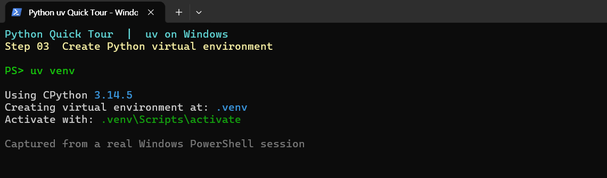
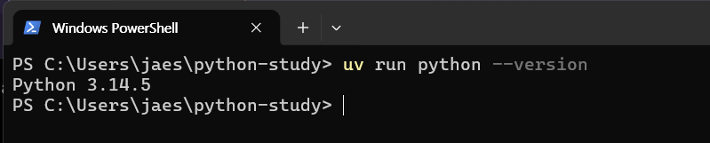

# 01. Python과 가상환경

## 가상환경이란?

프로젝트마다 **Python과 패키지를 분리하는 폴더**다. 다른 프로젝트와 패키지 버전이 달라도 서로 충돌하지 않는다.

## 만들고 확인하기 (Windows PowerShell)

앞의 [Quick Tour](README.md)에서 `python-study` 폴더와 `.venv`를 이미 만들었다면 **다시 만들 필요가 없다.**

아래에서 `#`으로 시작하는 명령은 **이미 실행한 단계이므로 주석 처리한 것**이다. 아직 실행하지 않은 단계에 한해 `#`을 지우고 실행한다.

**① `python-study` 폴더가 없다면**

```powershell
# mkdir python-study
```

**② 아직 `python-study` 폴더 안에 있지 않다면**

```powershell
# cd python-study
```

**③ 이 폴더에 `.venv`가 없다면**

```powershell
# uv venv
```

**④ Python 버전 확인 (실행)**

```powershell
uv run python --version
```

- `uv venv`: 사용 가능한 Python을 선택한다. 없으면 자동 다운로드한다.
- `uv venv --python 3.11`: 특정 버전 지정
- `uv python list`: 사용 가능한 Python 버전 확인





기존 Python·Anaconda 사용 중이라면 [고급 활용 Q&A](06-advanced.md#q1-기존-python이나-anaconda를-꼭-유지해야-하나)를 참고한다.

## .venv 안에는 무엇이 있나?

~~~text
python-study/
└── .venv/
    ├── pyvenv.cfg        # Python 환경 설정
    ├── .gitignore        # 가상환경을 Git 관리 대상에서 제외
    ├── Scripts/          # Windows: python.exe, 실행 스크립트 등
    └── Lib/
        └── site-packages/ # 설치된 패키지
~~~

운영체제·Python 구성에 따라 세부 파일은 다를 수 있다. macOS/Linux에서는 `Scripts/` 대신 `bin/`, 패키지 경로는 보통 `lib/pythonX.Y/site-packages/`다.

~~~powershell
Get-ChildItem -Force .venv
uv run python -c "import sys; print(sys.executable)"
~~~


**Q. 가상환경을 활성화해야 하나?**  
A. 필수는 아니다. `uv run python`으로 실행한다.

**Q. `python` 명령이 다른 버전을 실행한다면?**  
A. `uv run python`을 사용한다. 실제 실행 경로는 `uv run python -c "import sys; print(sys.executable)"`로 확인한다.

**Q. VS Code에서는?**  
A. **Python: Select Interpreter**에서 `.venv\Scripts\python.exe`를 선택한다.

macOS/Linux에서도 `uv run python`을 사용한다. 실제 실행 파일 경로는 `.venv/bin/python`이다.

관련 문서: [README](README.md) · [패키지 관리](02-packages.md)
