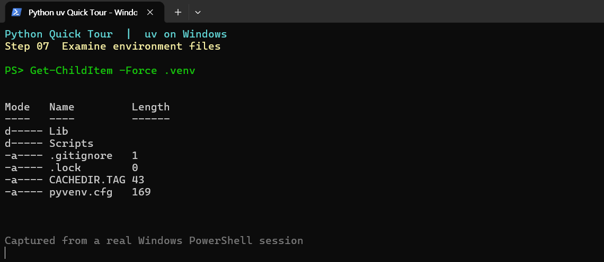

# 01. Python과 가상환경

[Quick Tour](README.md)에서 Notebook까지 실행했다면 **Python과 가상환경은 이미 준비되었다.** 이 장은 그 구성과 동작 원리를 이해하는 참고 자료다.

## Python과 가상환경의 차이

- **Python 인터프리터**: 작성한 Python 코드를 실행하는 프로그램
- **가상환경(`.venv`)**: 프로젝트마다 Python 실행 파일과 패키지를 분리해 사용하는 환경
- **uv**: Python 버전과 프로젝트 가상환경·패키지를 관리하는 도구

다른 프로젝트에 서로 다른 패키지 버전이 필요해도 환경이 분리되면 충돌을 줄일 수 있다.

## uv가 만든 가상환경 확인하기

Quick Tour의 `uv add --dev ipykernel` 단계에서 uv가 `.venv`를 준비한다. **이미 `.venv`가 있다면 `uv venv`를 다시 실행할 필요가 없다.**

프로젝트 설정이 없는 **별도 실습 폴더에서 가상환경만 만들 때**는 다음 명령을 사용한다. Quick Tour를 끝낸 경우에는 주석 그대로 두고 실행하지 않는다.

```powershell
# uv venv
```

PowerShell에서 `#`으로 시작하는 줄은 주석이므로 실행되지 않는다. 필요한 경우에만 `#`을 지워 실행한다.

### 가상환경의 파일 구조

```text
python-study/
└── .venv/
    ├── pyvenv.cfg         # Python 환경 설정
    ├── .gitignore         # Git 제외 설정
    ├── Scripts/           # Windows: python.exe
    └── Lib/
        └── site-packages/ # 설치된 패키지
```

실제 구성은 운영체제 및 Python 버전에 따라 달라질 수 있다. macOS/Linux에서는 `Scripts/` 대신 `bin/`을 사용한다.

**파일 목록 확인**

```powershell
Get-ChildItem -Force .venv
```



**실행 중인 Python 경로 확인**

```powershell
uv run python -c "import sys; print(sys.executable)"
```

결과가 프로젝트의 `.venv\Scripts\python.exe`를 가리키면 올바른 환경을 사용 중인 것이다. `uv run`을 사용하면 반드시 가상환경을 수동 활성화할 필요는 없다.

**다른 Python 버전이 필요하다면?** 기존 설치와 버전 선택에 대해서는 [06. 고급 Q&A](06-advanced.md)를 참고한다.

관련 문서: [Quick Tour](README.md) · [패키지 관리](02-packages.md) · [VS Code 커널 선택](07-vscode.md)
