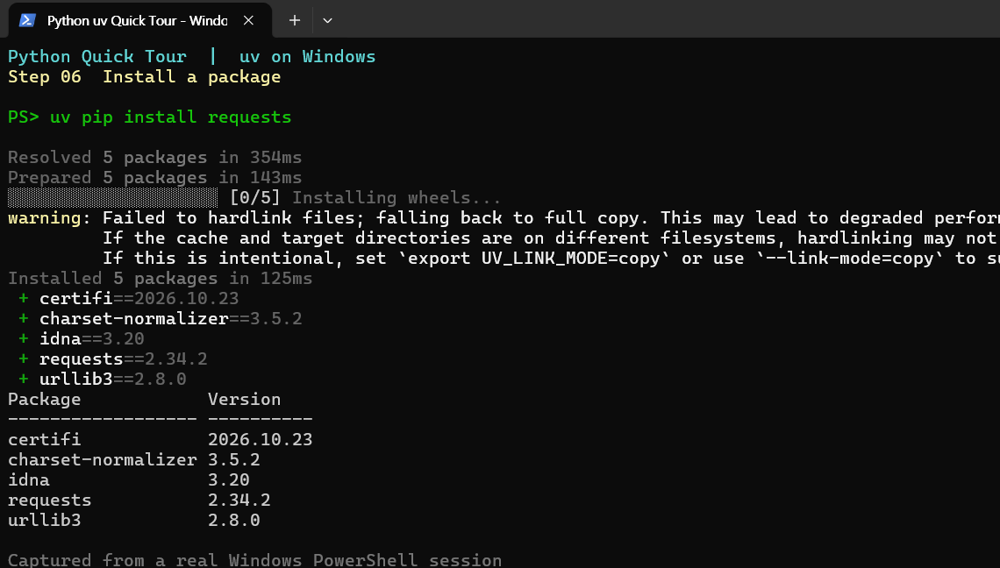
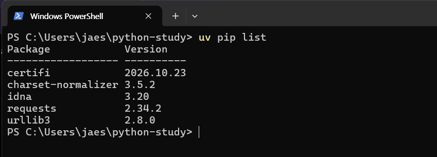
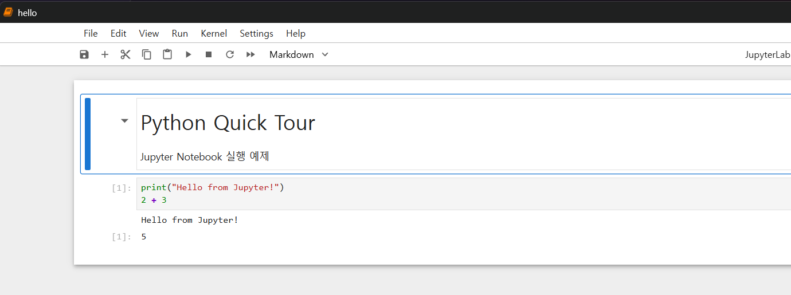
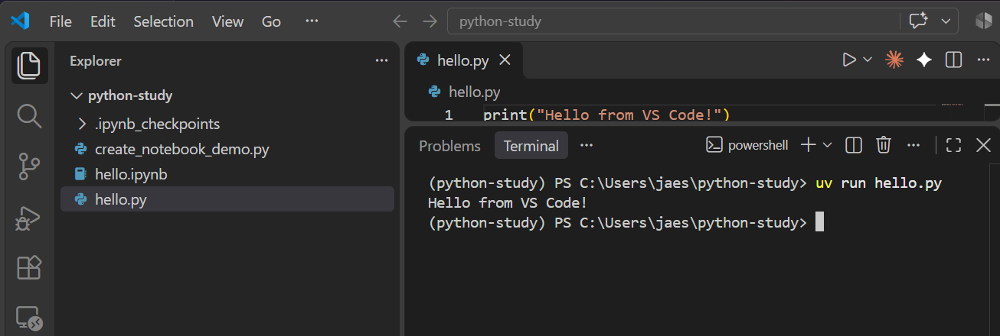

# 02. 패키지 설치·관리

외부 패키지는 **가상환경을 만든 폴더에서** 설치한다. 실행에는 `uv run`을 사용한다.

## 기본 명령 (Windows PowerShell)

~~~powershell
uv venv                           # 최초 1회: .venv 생성
uv pip install requests           # 설치
uv pip list                       # 설치 목록
uv pip show requests              # 패키지 정보
uv pip install --upgrade requests # 업데이트
uv pip check                      # 의존성 충돌 검사
~~~

설치 후 바로 확인한다.

~~~powershell
uv run python -c "import requests; print(requests.__version__)"
~~~





> 캐시와 가상환경이 서로 다른 드라이브에 있으면 파일 링크 대신 복사로 전환된다는 경고가 나올 수 있다. 패키지 설치는 정상적으로 완료된다.

## `uv pip install`과 `uv add` 차이

| 명령 | 역할 | 프로젝트 파일 |
|---|---|---|
| `uv pip install requests` | 현재 `.venv`에 설치 | 변경하지 않음 |
| `uv add requests` | 프로젝트 의존성으로 추가·설치 | `pyproject.toml`, `uv.lock` 갱신 |

- **간단한 실습:** `uv venv` → `uv pip install`
- **공유·재현할 프로젝트:** `uv init` → `uv add` → `uv sync`

`uv add`는 uv 프로젝트가 필요하다. 프로젝트에서 `uv pip install`만 사용하면 의존성이 기록되지 않아 이후 `uv sync`에서 빠질 수 있다.

## 여러 패키지와 버전 지정

~~~powershell
uv pip install requests pandas
uv pip install "requests==2.32.3"
uv pip uninstall requests
~~~

프로젝트 관리 방법은 [03. 프로젝트·환경 재현](03-projects.md)을 참고한다.

## Jupyter Notebook (선택)

**설치**

```powershell
uv pip install notebook ipykernel
```

**실행**

```powershell
uv run jupyter notebook
```



## VS Code에서 Python 실행 (선택)

[VS Code](https://code.visualstudio.com/)를 설치한 뒤 `python-study` 폴더에서 실행한다.

```powershell
code .
```

`hello.py` 파일 작성:

```python
print("Hello from VS Code!")
```

VS Code 터미널에서 실행:

```powershell
uv run hello.py
```



**Python: Select Interpreter**에서 `.venv`를 선택한다. `code` 명령이 인식되지 않으면 VS Code의 **파일 → 폴더 열기**를 사용한다.

**Q. 설치했는데 `import`가 실패한다면?**  
A. 실행 중인 Python과 설치한 환경이 같은지 확인한다.

~~~powershell
uv run python -c "import sys; print(sys.executable)"
uv pip show requests
~~~

관련 문서: [가상환경](01-install.md) · [오류 해결](04-troubleshooting.md)
