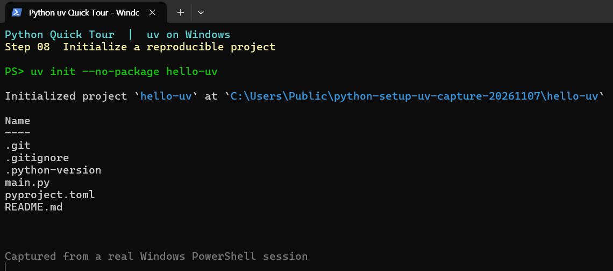
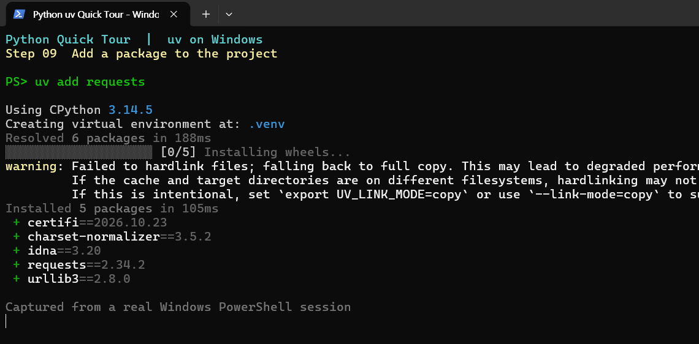
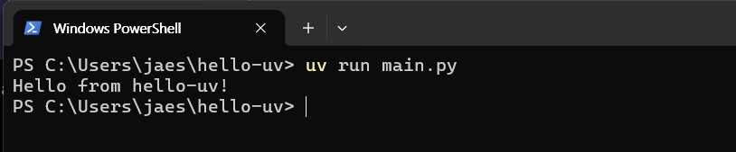

# 03. uv 프로젝트와 환경 재현

`uv venv`는 가상환경을 만든다. `uv init`은 **프로젝트 설정 파일까지** 만든다. 패키지는 **`uv add`로 설치하는 것을 권장**한다.

## 프로젝트 만들기 (Windows PowerShell)

~~~powershell
uv init --no-package hello-uv
cd hello-uv
uv add requests
uv run main.py
~~~

`--no-package`는 입문자가 보기 쉬운 `main.py` 중심 구조를 만든다. 일반 `uv init`의 기본 템플릿은 uv 버전에 따라 다를 수 있다.

## 중요한 파일

~~~text
hello-uv/
├── main.py          # 실행할 코드
├── README.md        # 프로젝트 설명
├── pyproject.toml    # 프로젝트 설정·의존성
├── .python-version   # 사용할 Python 버전
├── .gitignore        # Git 제외 규칙
├── uv.lock           # 확정된 의존성 (uv add/run/sync 후)
└── .venv/            # 로컬 실행환경 (첫 실행·동기화 후)
~~~

Git이 설치되어 있고 버전 관리가 초기화되었다면 `.git/`도 존재한다. 파일 생성 시점은 uv 명령과 환경에 따라 다를 수 있다.

## 패키지 추가·삭제 및 실행

~~~powershell
uv add requests
uv remove requests
uv run main.py
uv sync
~~~

- `uv add`: `pyproject.toml`과 `uv.lock`에 의존성 반영 ([`uv pip install`과 차이](02-packages.md))
- `uv run`: 필요한 환경을 동기화한 뒤 실행
- `uv sync`: 프로젝트 설정에 맞춰 `.venv` 재구성

프로젝트가 많아졌을 때 폴더 구조와 디스크 공간 관리 방법은 [고급 활용 Q&A](06-advanced.md#q4-프로젝트를-만들-때-폴더는-어떻게-구성하면-좋을까)를 참고한다.

## 다른 컴퓨터에서 재현하기

GitHub에 `pyproject.toml`, `uv.lock`, `.python-version`, 소스코드를 저장한다. `.venv/`는 업로드하지 않는다.

~~~powershell
git clone https://github.com/사용자명/저장소명.git
cd 저장소명
uv sync
uv run main.py
~~~

> 📷 **화면 캡처 자리:** 다른 컴퓨터에서 `uv sync` 성공 및 `uv run` 출력

**Q. Git도 자동 설치되나?**  
A. 아니다. Git은 별도로 설치한다. uv 프로젝트는 Git 없이도 만들고 실행할 수 있다.

공식 문서: [프로젝트 생성](https://docs.astral.sh/uv/concepts/projects/init/) · [프로젝트 사용](https://docs.astral.sh/uv/guides/projects/)
