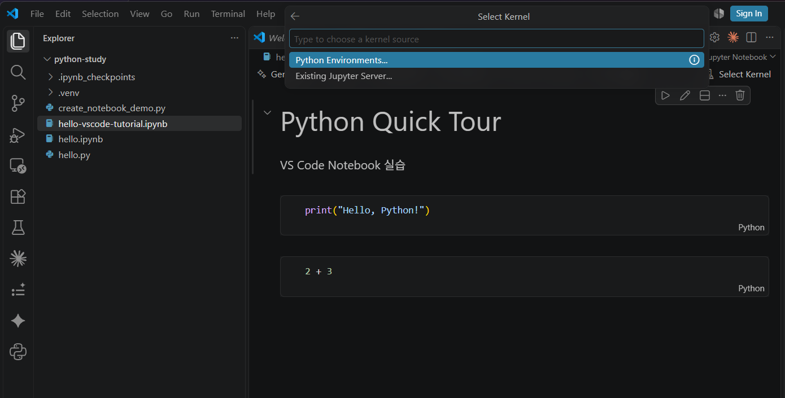
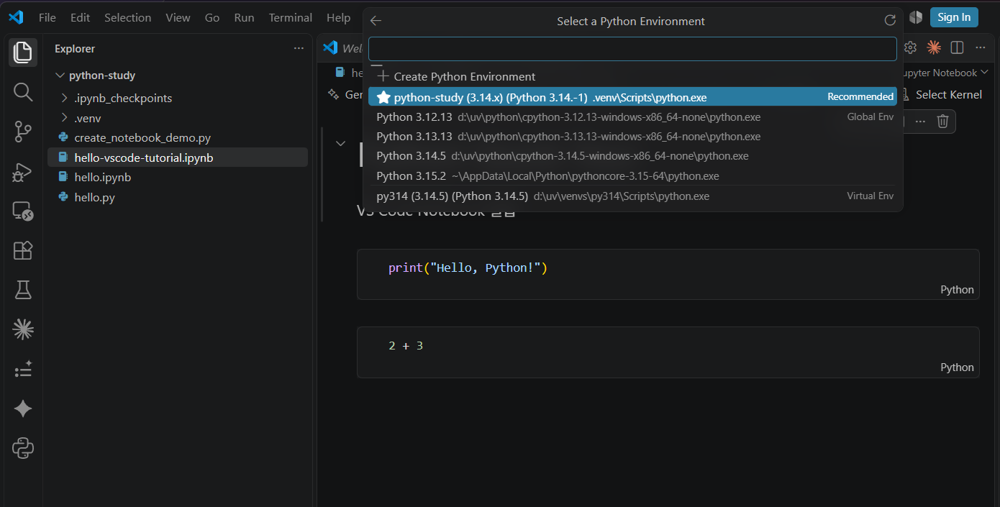
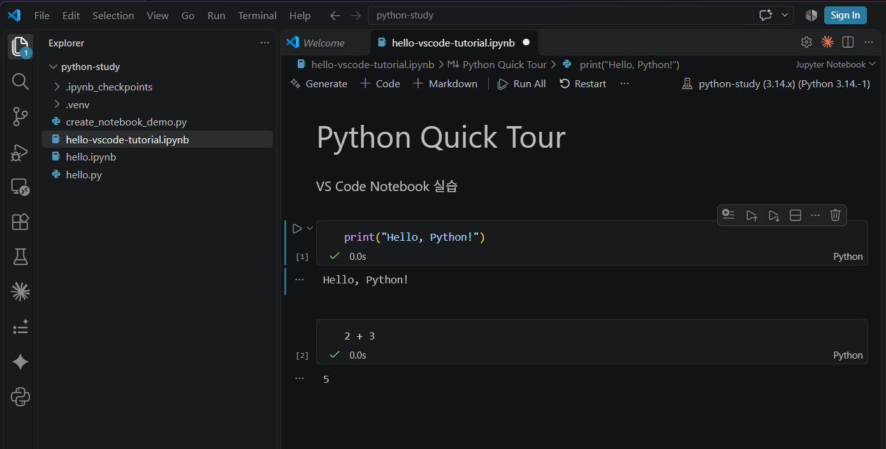
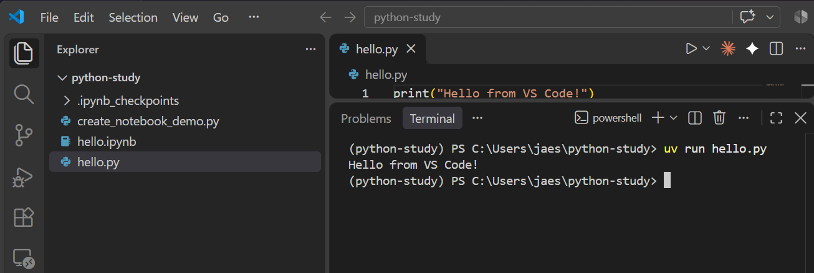
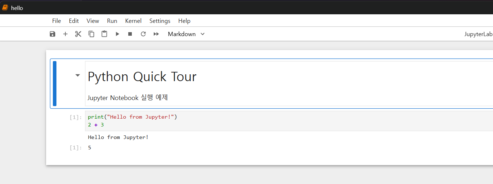

# 07. VS Code 설치·설정·Notebook 상세 안내

[Quick Tour](README.md)만으로 설치부터 첫 Notebook 실행까지 진행할 수 있다. 여기서는 **VS Code 설치 확인, Python·Jupyter 확장, 커널 선택, 오류 해결**을 자세히 설명한다. Windows 11 PowerShell 기준이다.

**메뉴·설치 화면을 클릭하는 방식도 가능하다.** `winget`, `code --install-extension`, `code .`는 각각 다운로드·설치·폴더 열기 작업을 **명령어로 간편하게 처리하는 대안**이다. 자신에게 편한 방법 한 가지를 선택하면 된다.

## 1. VS Code 설치

**화면에서 설치:** [VS Code 공식 다운로드 페이지](https://code.visualstudio.com/download)에서 Windows 설치 프로그램을 내려받고 안내에 따라 설치한다.

**명령어로 설치:** 일반 Windows 11에서는 `winget`으로 위 다운로드·설치 과정을 간편하게 진행할 수 있다. 이미 설치되어 있다면 건너뛴다.

```powershell
winget install --id Microsoft.VisualStudioCode -e
```

`winget`이 없다면 [VS Code 공식 다운로드](https://code.visualstudio.com/download)에서 Windows용 설치 프로그램을 받는다. Windows Sandbox에는 `winget`이 기본 제공되지 않을 수 있다.

설치 후 **PowerShell을 닫고 새로 열어** 실행 명령을 확인한다.

```powershell
code --version
```

`code`가 인식되지 않는다면 VS Code를 완전히 종료하고 PowerShell도 다시 연다. 여전히 실행되지 않는다면 Windows의 시작 메뉴에서 VS Code를 직접 실행해 **파일 → 폴더 열기**를 이용할 수 있다.

## 2. 확장 설치

VS Code의 확장(Extensions)은 Python 언어 지원과 Notebook 실행 기능을 추가한다.

**화면에서 설치:** VS Code 왼쪽 **Extensions** 아이콘 클릭(단축키 `Ctrl+Shift+X`) → 검색창에 **Python** 입력 → 게시자가 **Microsoft**인 Python 확장 선택 → **Install**. 같은 절차로 **Jupyter** 확장도 설치한다.

**명령어로 설치:** 아래 `code --install-extension` 두 명령을 순서대로 실행하면 위 메뉴 조작과 동일하게 설치할 수 있다. 이미 설치되어 있다면 생략한다.

**Python 확장 (Microsoft)**

```powershell
code --install-extension ms-python.python
```

**Jupyter 확장 (Microsoft)**

```powershell
code --install-extension ms-toolsai.jupyter
```

## 3. uv 프로젝트 열기

아직 실습을 시작하지 않았다면 먼저 [Quick Tour](README.md#4-python-실습-프로젝트-만들기)에서 `python-study`를 만든다. 앞에서 이미 만들었다면 **중복으로 생성하지 않는다.**

`python-study` 폴더에서 실행한다. VS Code에서 **파일 → 폴더 열기** 메뉴로 직접 열어도 같은 결과다.

```powershell
code .
```

다른 프로그램에서 받은 프로젝트를 열 때는 VS Code의 **파일 → 폴더 열기**로 해당 폴더를 선택한다.

## 4. Notebook용 Python 커널 준비

VS Code Jupyter 확장은 코드 셀을 실행하기 위해 Python 환경에 `ipykernel`이 필요하다. **Python 프로젝트에 별도의 Jupyter 서버 패키지를 설치할 필요는 없다.**

**구분:** Python·Jupyter는 **VS Code 확장 메뉴에서 설치하는 확장**이고, `ipykernel`은 **Python 프로젝트에 `uv`로 설치하는 패키지**다. PowerShell이나 VS Code의 터미널에서 아래 명령을 실행한다.

프로젝트에 아직 설치하지 않았다면:

```powershell
uv add --dev ipykernel
```

[Quick Tour](README.md#5-notebook-실행에-필요한-커널-설치)에서 설치했다면 다시 실행하지 않는다. `uv add --dev`는 개발용 패키지를 프로젝트 설정에 기록한다.

## 5. Notebook 만들기·커널 선택·셀 실행

1. VS Code에서 `Ctrl+Shift+P`를 누른다.
2. `Create: New Jupyter Notebook`을 입력해 실행하거나 `hello.ipynb` 파일을 만든다.
3. Notebook 오른쪽 위의 **Select Kernel**을 누르고 **Python Environments**를 고른다.

   

4. Python 환경 목록에서 **`python-study\.venv\Scripts\python.exe`**를 고른다. 다른 Python이 여러 개 있어도 경로가 현재 프로젝트의 `.venv`인지 확인한다.

   

5. 셀에 코드를 넣은 뒤 ▶ 버튼을 눌러 실행한다.

```python
print("Hello, Python!")
```

출력이 나타나면 Notebook 실행에 성공한 것이다.

```text
Hello, Python!
```

두 번째 셀에서 `2 + 3`을 실행하면 `5`가 출력된다. 아래 화면은 **실제 VS Code에서 두 셀을 실행한 결과**다.



파일은 `Ctrl+S`로 `.ipynb` 확장자로 저장한다.

> 화면 구성이 VS Code 버전에 따라 다를 수 있다. 위 경로는 Windows용이다. macOS/Linux에서는 `.venv/bin/python`을 선택한다.

## 6. Python 파일도 VS Code에서 실행하기

Notebook 외에 `.py` 파일도 작성할 수 있다. `hello.py`를 만든 다음 코드를 입력한다.

```python
print("Hello from VS Code!")
```

프로젝트 터미널에서 실행한다.

```powershell
uv run hello.py
```



## 7. 브라우저에서 Notebook을 사용하려면?

**VS Code 안의 Notebook은 `ipykernel`만 설치**하면 된다. 브라우저에서 JupyterLab을 열고 싶은 경우에만 Jupyter 서버를 추가로 실행한다.

```powershell
uv run --with jupyter jupyter lab
```



이 명령은 필요한 도구를 일시적으로 준비하며 일반 프로젝트 의존성으로 기록하지 않는다.

## 8. 막힐 때 확인할 것

| 증상 | 확인·해결 |
|---|---|
| `winget`이 없음 | Windows Sandbox는 기본 미포함. 공식 다운로드로 VS Code 설치 |
| `code` 명령을 찾지 못함 | 설치 후 PowerShell과 VS Code를 새로 열기, 시작 메뉴에서 실행 |
| Notebook이 실행되지 않음 | Python·Jupyter 확장 설치 여부, **Select Kernel** 확인 |
| 커널을 찾을 수 없음 | 프로젝트 폴더 확인 후 `uv add --dev ipykernel` 실행 |
| VS Code가 다른 Python을 선택함 | **Python: Select Interpreter**에서 `.venv` 선택 |
| 설치했는데 `import` 실패 | [04. 문제 해결](04-troubleshooting.md)의 환경 경로 확인 |

공식 자료: [VS Code Jupyter Notebooks](https://code.visualstudio.com/docs/datascience/jupyter-notebooks) · [VS Code 커널 선택](https://code.visualstudio.com/docs/datascience/jupyter-kernel-management) · [Astral uv와 VS Code Notebook](https://docs.astral.sh/uv/guides/integration/jupyter/)
