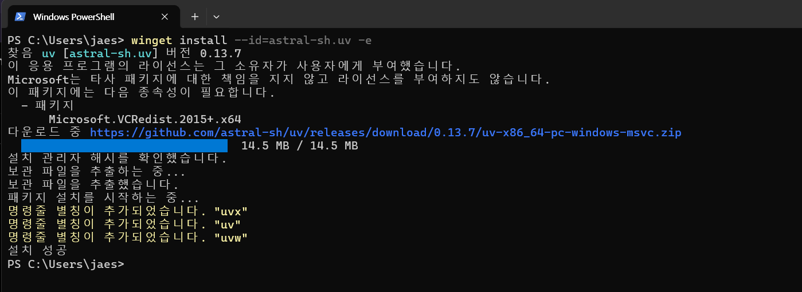
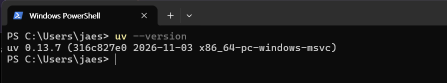
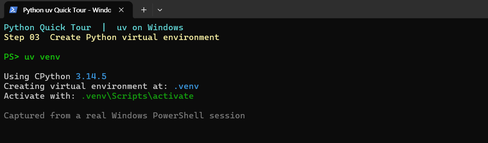
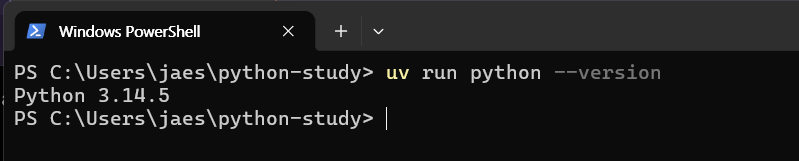
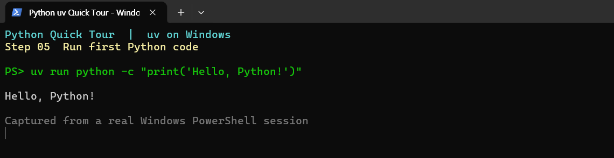

# Python 개발환경 Quick Tour — uv로 시작하기

Windows 기준 실습 가이드. macOS/Linux는 [별도 설치 안내](05-macos-linux.md)를 참고한다.

Python은 [python.org](https://www.python.org/downloads/)에서 설치할 수도 있지만, 여기서는 **uv**로 설치·관리한다.

**uv**는 Windows·macOS·Linux에서 작동하는 빠른 Python 관리 도구다.

| 장점 | 설명 |
|---|---|
| 간편함 | 명령어로 Python·가상환경·패키지 관리 |
| 자동 설치 | 필요한 Python 버전이 없으면 다운로드 |
| 여러 버전 | 프로젝트마다 다른 Python 환경 사용 |
| 빠른 속도 | 패키지 설치와 캐시 재사용 |
| OS 공통 사용 | 한번 배우면 Windows·macOS·Linux에서 동일한 uv 명령 활용 |
| AI 협업 | 설치·실행·오류 확인 절차를 명령어로 공유 |

## Windows에서 시작하기 (PowerShell)

**1. uv 설치**

```powershell
winget install --id=astral-sh.uv -e
```



**2. 새 PowerShell에서 설치 확인**

```powershell
uv --version
```



**3. 작업 폴더 생성**

```powershell
mkdir python-study
```

**4. 작업 폴더로 이동**

```powershell
cd python-study
```

**5. Python 가상환경 생성**

```powershell
uv venv
```



**6. Python 버전 확인**

```powershell
uv run python --version
```



**7. Python 실행 확인**

```powershell
uv run python -c "print('Hello, Python!')"
```




`uv venv`는 사용 가능한 Python을 활용하고, 없으면 자동으로 다운로드한다. 기본 가상환경은 `.venv` 폴더에 생성된다. **반드시 최신 Python을 선택하는 것은 아니다.** `uv run`은 이 가상환경에서 Python을 실행한다.

특정 버전이 필요하면:

~~~powershell
uv venv --python 3.11
~~~

패키지 관리에는 프로젝트 정보를 함께 기록하는 **`uv add`를 권장**한다. `uv init`과 `uv add` 사용법은 [패키지 관리](02-packages.md)를 참고한다.

**기존 Python·Anaconda 정리, uv 업데이트, 디스크 용량과 폴더 관리**는 [고급 활용 Q&A](06-advanced.md)를 참고한다.

## 자세히 보기

- [01. Python·가상환경과 생성 파일](01-install.md)
- [02. 패키지 설치·관리](02-packages.md)
- [03. 프로젝트 생성·환경 재현](03-projects.md)
- [04. 자주 발생하는 오류](04-troubleshooting.md)
- [05. macOS / Linux 설치](05-macos-linux.md)
- [06. 고급 활용 Q&A — 기존 환경·용량·폴더 정리](06-advanced.md)

**참고:** uv를 설치해도 Git은 함께 설치되지 않는다. Git·GitHub는 별도로 다룬다.

공식 자료: [uv 설치](https://docs.astral.sh/uv/getting-started/installation/) · [Python 자동 설치](https://docs.astral.sh/uv/guides/install-python/)
